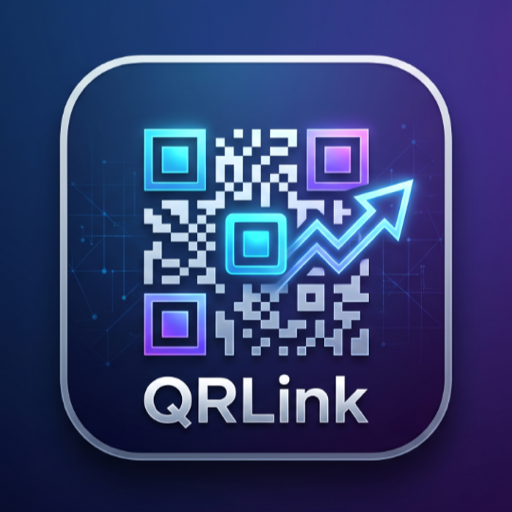

# QRLink Studio — Flutter QR Code Generator & Scanner

<p align="center">
  
</p>

<p align="center">
  <b>A modern, offline-first mobile application to create, customize, scan, and export high-resolution QR codes.</b>
</p>

<p align="center">
  
  
  
  
  
  
</p>

---

## 📱 Features Overview

### 1. 19+ Supported QR Types
QRLink Studio provides purpose-built forms with input validation and standard payload serializers for every use case:

| Category | Supported Types |
| :--- | :--- |
| **Web & Links** | Website / URL, Multi-URL Link Tree (Bio Link Hub) |
| **Communication** | Contact Card (vCard 3.0), Email (with Subject & Body), Phone (Tel), SMS |
| **Social Media** | WhatsApp, Telegram, Instagram, Facebook, X (Twitter), YouTube, LinkedIn, TikTok, Spotify |
| **Connectivity & Utils** | Wi-Fi Networks (WPA/WPA2/WPA3, WEP, Open, Hidden SSID), Google Maps Coordinates, Plain Text, Calendar Events (iCal) |
| **Payments** | UPI Payments (Google Pay, PhonePe, Paytm, BHIM with Merchant VPA & Amount) |

---

### 2. Deep Visual Customization Studio
Transform standard black-and-white QR codes into branded marketing assets in real time:

- **Body Patterns**: 6 distinct module matrix shapes:
  - Classic Square
  - Rounded Dots
  - Continuous Smooth Connectors
  - Diamond
  - Star
  - Fluid Organic Curves
- **Eye & Corner Styles**: Independently customize the outer frame and inner pupil:
  - Square, Rounded Square, Circle, Leaf, and Diamond.
- **Color Palettes & Gradients**:
  - Solid custom colors (hex, RGB, HSL)
  - Two-color Linear Gradients (Horizontal, Vertical, Diagonal ↘, Inverse Diagonal ↗)
  - Radial Gradients
  - Transparent backgrounds for overlaying on posters and artwork
- **Embedded Logos & Brand Badges**:
  - 12+ pre-bundled social and utility icons
  - Custom logo upload from photo gallery
  - Adjustable logo scale, background clearance padding, and squircle border radius
- **Marketing CTA Frames**:
  - 5 Call-To-Action frames (*"Scan Me"*, *Top Header*, *Bottom Banner*, *Pill*, *Card Accent*)
  - Custom frame text and color accents

---

### 3. Integrated Camera & Gallery Scanner
- Real-time viewfinder scanning with flash/torch control and camera flip.
- Scan QR codes directly from saved gallery images.
- Smart payload recognition:
  - Instant one-tap actions (Launch Website, Open UPI App to pay, Dial Number, Send SMS/Email, View on Google Maps).
  - Automatically saves scanned codes to local history.

---

### 4. High-Resolution Export & Printing
- Export at multiple pixel ratios: **HD (1.5x)**, **2K High (3.0x)**, and **Ultra 4K Print-Ready (4.0x)**.
- Direct save to device photo library (`gal`).
- Native system share sheet (`share_plus`).
- Print-ready **A4 PDF document generation** with labels and payload descriptions (`pdf` & `printing`).

---

### 5. Local Database & Offline-First
- Fast local persistence using **Hive**.
- Organize codes with filter categories: *All*, *Created*, *Scanned*, and *Favorites*.
- Real-time search across titles and payloads.

---

### 6. Design & Theming
- **Material 3 Expressive System** with curated `#00008B` brand color palette.
- Dynamic **Light & Dark Mode** with high-contrast form fields, pure white borders, and focused states.
- Clean typography powered by **Google Fonts (Plus Jakarta Sans)**.

---

## 🛠 Tech Stack & Architecture

- **Framework**: [Flutter](https://flutter.dev) (Dart SDK `^3.11.5`)
- **Architecture**: Clean Architecture (Domain, Data, Presentation layers)
- **State Management**: [Riverpod 2.6](https://riverpod.dev)
- **Routing**: [GoRouter](https://pub.dev/packages/go_router)
- **Database**: [Hive Flutter](https://pub.dev/packages/hive_flutter)
- **Camera Scanning**: [Mobile Scanner 7.0](https://pub.dev/packages/mobile_scanner)
- **Rendering & Capture**: [CustomPainter Canvas Rendering](lib/presentation/widgets/qr_canvas_widget.dart) & [Screenshot](https://pub.dev/packages/screenshot)
- **Document & Print**: [pdf](https://pub.dev/packages/pdf) & [printing](https://pub.dev/packages/printing)

---

## 📂 Project Structure

```
lib/
├── core/
│   ├── router/
│   │   └── app_router.dart          # GoRouter centralized route definitions
│   └── utils/
│       └── payload_serializer.dart  # Payload formatters (vCard, Wi-Fi, UPI, etc.)
├── data/
│   ├── models/
│   │   ├── qr_item.dart             # QR entity model (Hive Type)
│   │   ├── qr_style_config.dart     # Comprehensive visual style configuration
│   │   └── qr_type.dart             # 19 QR types and categories definition
│   └── repositories/
│       └── qr_repository.dart       # Hive local persistence implementation
├── domain/
│   └── repositories/
│       └── i_qr_repository.dart     # Abstract repository contract
├── presentation/
│   ├── providers/
│   │   ├── qr_creator_provider.dart # Creator state & payload binding
│   │   ├── qr_history_provider.dart # History search, filters, & CRUD
│   │   ├── repository_provider.dart # Dependency injection provider
│   │   ├── scanner_provider.dart    # Scan processing & deep linking
│   │   └── theme_provider.dart      # Dark/Light mode state management
│   ├── screens/
│   │   ├── customizer_screen.dart   # Interactive studio with live preview
│   │   ├── history_screen.dart      # Saved database & filter chips
│   │   ├── home_screen.dart         # Type catalog & navigation bar
│   │   ├── input_form_screen.dart   # Dynamic forms for each QR type
│   │   ├── scanner_screen.dart      # Fullscreen camera viewfinder
│   │   └── splash_screen.dart       # Animated brand intro screen
│   └── widgets/
│       ├── export_dialog.dart       # Multi-resolution export & PDF dialog
│       ├── qr_canvas_widget.dart    # CustomPainter rendering engine
│       └── qr_frame_wrapper.dart    # Frame & badge overlay container
└── main.dart                        # App entry point, M3 theme, Riverpod scope
```

---

## 🚀 Getting Started

### Prerequisites
- [Flutter SDK](https://docs.flutter.dev/get-started/install) (`>= 3.24.0`)
- Android Studio / Xcode
- CocoaPods (for iOS)

### Installation

1. **Clone the repository:**
   ```bash
   git clone https://github.com/subinjose11/qr_code_generator.git
   cd qr_code_generator
   ```

2. **Install dependencies:**
   ```bash
   flutter pub get
   ```

3. **Configure Firebase:**
   The project is pre-configured with Firebase Core, Auth, Firestore, Crashlytics, and Analytics. For a quick start or testing, copy the template config:
   ```bash
   cp lib/firebase_options.example.dart lib/firebase_options.dart
   ```
   Or link your own Firebase project with FlutterFire CLI:
   ```bash
   flutterfire configure
   ```

4. **Run tests:**
   ```bash
   flutter test
   ```

5. **Run the application:**
   ```bash
   # Android
   flutter run -d android

   # iOS Simulator
   flutter run -d ios
   ```

---

## 🧪 Testing

The project maintains test coverage across providers and core widgets:

```bash
flutter test
```

Test suite covers:
- Dependency injection overrides
- History CRUD operations & favorites toggle
- Payload serialization & QR creator state changes
- Camera raw data normalization (URLs, Wi-Fi, vCard, UPI)
- Widget smoke & navigation flows

---

## 📄 License

This project is licensed under the MIT License — see the [LICENSE](LICENSE) file for details.
